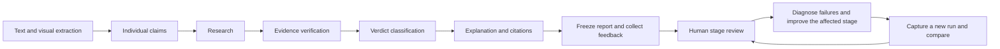

# Fact-check evaluation and feedback

TruthGuard's seventh processing stage is an evaluation and feedback loop around
the six inference stages. Human reviewers identify which stage needs correction;
user flags nominate cases for review. Neither changes a factual verdict by itself.



## Review rubric

| Stage | What to inspect |
| --- | --- |
| `extraction` | Compare readable text and visible subjects with the original upload. Preserve amounts, names, dates and uncertainty. Descriptions must not invent an owner, price, identity or location. |
| `claims` | Check that each material assertion was captured with its original scope. Separate factual questions, opinions, estimates and assumptions. |
| `retrieval` | Check whether relevant accessible records were found. Search beyond the preferred publishers when needed. Record known missed sources and their dates; a similar topic is not necessarily the same claim. |
| `evidence` | Read the actual passages. Check entities, dates, places, numbers, qualifiers and contrary evidence. Distinguish plans from completed actions and totals from per-unit amounts. |
| `verdict` | Check each claim outcome and the aggregate result against the evidence available at the evaluation cutoff. Lack of evidence alone cannot establish False. |
| `explanation_citations` | Check that the explanation answers the question, preserves uncertainty and cites sources that establish its material statements. |

Every stage starts `unreviewed`. A reviewer may assign `pass`, `fail` or
`not_applicable`, with an explanatory note, actual reviewer identity, review date
and `human_reviewed=true`. Use ISO dates such as `2026-11-09` and record relevant
source links in `evidence_urls`. State whether the reviewer is independent of
development; the software records this declaration but cannot verify it.

Use `not_applicable` with a reason when a stage was legitimately bypassed, such as
fresh web retrieval on a saved-answer reuse check. Missing telemetry or an
unavailable original image does not establish a pass; leave the stage unreviewed
and explain the limitation. Review contextual and secondary assessments in the
original archive when they are material to the task.

## Review a saved report without new API calls

From the repository root, use PHP 8.3 or later and Python 3.10 or later. On this
Laragon installation, the supported PHP executable is
`C:/laragon/bin/php/php-8.4.15-nts-Win32-vs17-x64/php.exe`; use it in place of `php`
if the shell resolves an older installation.

```powershell
New-Item -ItemType Directory -Force output/pipeline-review/run-1
php artisan truthguard:export-pipeline-review output/pipeline-review/run-1/reports.jsonl --detection=20
python automation/evaluation/evaluate_pipeline.py --reports output/pipeline-review/run-1/reports.jsonl --prepare output/pipeline-review/run-1/reviews.jsonl
```

Repeat `--detection=ID` for multiple reports, or use `--flagged` to select reports
with user feedback. Combining the options restricts to flagged reports among
those IDs. Exports include completed factual/context reports only, at most 100
selected records by default (`--take` accepts 1–1000). Pending and media-only
reports are excluded. The export reads existing results and makes no API calls.

The archive contains saved input, source records, extracted text/visual context,
claims, evidence relationships, verdict, explanation, and any user feedback
already available in the report. No previously missing telemetry is fabricated.
The JSONL review sheet includes compact observations and a hash binding every
review to its original archive record. Keep the full archive for detailed review.
It includes the generated public wording and `answer_validation` diagnostics;
review the actual displayed explanation as well as the original evidence summary.

Inspect the original upload and sources, then edit the stage judgments in
`reviews.jsonl`. Leave unfinished rows in place. Generate the summary:

```powershell
python automation/evaluation/evaluate_pipeline.py --reports output/pipeline-review/run-1/reports.jsonl --reviews output/pipeline-review/run-1/reviews.jsonl --output-dir output/pipeline-review/run-1/summary
```

Open `summary/report.html` to see stage counts, reviewed pass rates and individual
failures. `report.json` additionally separates independent and development review
and records artifact hashes. Prepare/export commands and report directories refuse
overwrite. Re-run inference and export into a new directory after a fix.

The same tool accepts `*.reports.jsonl` from the existing
`truthguard:capture-evidence` command for newly captured factual/context runs.
Gold labels and stage review notes are not sent into inference. Saved reports
are diagnostic cases, not automatically independent held-out test cases.

## Feedback loop

The result page's **Something wrong with this result?** form lets the report owner
select a stage-specific issue and supply an optional note or source link. Feedback
stores `unverified_user_report`, the stage, the reported verdict and a hash of the
result at reporting time. Existing media-origin feedback retains its separate
detector snapshot and is not counted as fact-check stage accuracy.

Admin fact-check reviews already expose the feedback category, note and snapshot
metadata. The export command includes this feedback for triage. If a report was
subsequently retried or revised, inspect its historical snapshot/revision before
assuming the old complaint applies to the exported result.

Reviewers should investigate the earliest observed failed stage, preserve all
other observed failures, make a targeted fix, and capture a separate comparison
run. An early failure can propagate downstream; the first observed failure is
not automatically a proven root cause. User reports never become training labels,
approved saved answers or independent evidence without actual review.

## What the numbers mean

For each stage, the diagnostic reports `pass / (pass + fail)` and the explicit
review coverage `(pass + fail) / all captured cases`. Unreviewed and inapplicable
stages do not count as successful judgments. With no assessed stages, the report
is `unmeasured` and pass rates are null. A wrong verdict can coexist with a correct
extraction; a correct verdict can coexist with unsupported citations.

These are stage-review diagnostics, not measured deployment accuracy, model
confidence, or video validation results. For accuracy claims, use independently
reviewed labels, an explicit evaluation cutoff, event/media-group split controls,
and the existing [held-out evaluation tools](../automation/evaluation/README.md).
Keep ground-truth labeling separate from this output-aware error analysis.

Software checks:

```powershell
python -m unittest discover -s automation/evaluation -p test_evaluate_pipeline.py -v
php artisan test tests/Feature/DetectionFeedbackTest.php tests/Feature/ExportPipelineReviewTest.php
```

These fixture tests validate bookkeeping and access controls, not factual accuracy.
